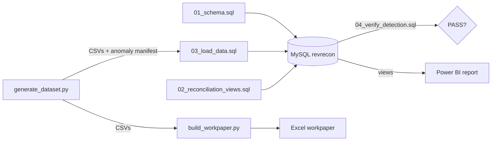

# RevRecon: Revenue Leakage & SLA Billing Reconciliation

Metered usage, contract terms and invoices live in three systems that nobody
reconciles. RevRecon checks every contract-month and finds three kinds of
leakage:

| Exception | What happened | Who it hurts |
| --- | --- | --- |
| `UNBILLED_USAGE` | Usage was metered but never invoiced | Us: lost revenue |
| `TIER_PRICING_VARIANCE` | The invoice used another tier's discount | Either side: under- or over-billed |
| `MISSED_SLA_CREDIT` | A breach month was billed at full price | The customer: overcharged, and the contract breached |

On the synthetic dataset, the reconciliation finds **70 exceptions across 691
contract-months**. That is **4,507.45 net leakage (2.82% of expected
revenue)** and 7,640.83 gross exposure once over-billing is counted. It finds
every seeded anomaly, with no false positives.



## What's in the box

| Path | Contents |
| --- | --- |
| [`docs/BRD.md`](docs/BRD.md) | Problem, stakeholder matrix, scope, KPIs, business rules, 6 Gherkin acceptance criteria, open questions |
| [`docs/data_dictionary.md`](docs/data_dictionary.md) | Every table, view and column: keys, nullability, business definition |
| [`docs/user_stories.md`](docs/user_stories.md) | User stories traced to the acceptance criteria |
| [`sql/01_schema.sql`](sql/01_schema.sql) | Star schema: `dim_customer`, `dim_contract`, `fact_usage_events`, `fact_invoices` |
| [`sql/02_reconciliation_views.sql`](sql/02_reconciliation_views.sql) | CTE and window-function views: expected vs billed, SLA credits, orphaned usage |
| [`sql/03_load_data.sql`](sql/03_load_data.sql) | `LOAD DATA` for the generated CSVs |
| [`sql/04_verify_detection.sql`](sql/04_verify_detection.sql) | Proves the views catch exactly the seeded anomalies |
| [`scripts/generate_dataset.py`](scripts/generate_dataset.py) | Synthetic data, 57k usage events, with anomalies seeded at 3% / 5% / 2% |
| [`scripts/build_workpaper.py`](scripts/build_workpaper.py) | Excel audit workpaper with independent re-performance |
| [`powerbi/dax_measures.md`](powerbi/dax_measures.md) | Semantic model and DAX: leakage, exposure, dynamic SLA credit, time intelligence |
| [`powerbi/dashboard_spec.md`](powerbi/dashboard_spec.md) | Four report pages: layout, visuals, states, theme |
| [`workpapers/`](workpapers/) | The generated reconciliation workpaper |

## 1. Generate the data

Requires Python 3.12 or later.

```powershell
python -m venv .venv
.\.venv\Scripts\python.exe -m pip install -r scripts\requirements.txt
.\.venv\Scripts\python.exe scripts\generate_dataset.py
```

This writes to `data/`: `dim_customer.csv`, `dim_contract.csv`,
`fact_usage_events.csv`, `fact_invoices.csv` and `anomaly_manifest.csv` (the
ground truth). The output is deterministic for a given `--seed` (default 42).
Use `--customers N` to scale it up. The script checks its own anomaly rates
and stops if they drift.

| Anomaly | Seeded rate | Realised (seed 42) |
| --- | --- | --- |
| Unbilled usage events | 3% of events | 1,724 / 57,071 = 3.02% |
| Incorrect tier pricing | 5% of invoices | 33 / 667 = 4.95% |
| Missed SLA credit | 2% of invoices | 13 / 667 = 1.95% |

The invoice-based rates are as close to 5% and 2% as whole invoices allow.

## 2. Load and reconcile in MySQL

Requires MySQL 8.0.16+ with `local_infile` enabled. Run these from the
repository root, because the load script uses relative paths:

```bash
mysql -u root -p < sql/01_schema.sql
mysql -u root -p < sql/02_reconciliation_views.sql
mysql --local-infile=1 -u root -p < sql/03_load_data.sql
mysql -u root -p --table < sql/04_verify_detection.sql
```

If the load fails with error 3948, run `SET GLOBAL local_infile = 1;` as an
admin. `01_schema.sql` drops and recreates the `revrecon` tables.

**Expected result:** every row of the verification query reads `PASS`.

```
| check_name            | seeded | detected | missed | false_positives | result |
| MISSED_SLA_CREDIT     |     13 |       13 |      0 |               0 | PASS   |
| ORPHANED_EVENTS       |   1724 |     1724 |        |                 | PASS   |
| SLA_CREDIT_MISSED     |     13 |       13 |        |                 | PASS   |
| TIER_PRICING_VARIANCE |     33 |       33 |      0 |               0 | PASS   |
| UNBILLED_USAGE        |     24 |       24 |      0 |               0 | PASS   |
```

No local MySQL? A throwaway Docker container works; see
[`docs/VERIFY.md`](docs/VERIFY.md).

### The views

| View | Answers | Techniques |
| --- | --- | --- |
| `vw_billing_reconciliation` | Expected tier charge vs invoiced amount, classified by root cause | CTE chain, `LEFT JOIN` for unbilled periods, `SUM() OVER` running leakage, `ROW_NUMBER()` exception rank |
| `vw_sla_breach_credits` | Which months breached the SLA, the credit owed, and whether it was applied | Exact integer breach test, `COUNT() OVER` repeat-breach counter, `ROW_NUMBER()` severity rank |
| `vw_orphaned_usage_events` | Usage events no invoice ever covered | `NOT EXISTS` anti-join, named `WINDOW` clauses for per-gap totals |

## 3. Build the Excel workpaper

```powershell
.\.venv\Scripts\python.exe scripts\build_workpaper.py
```

This writes `workpapers/RevRecon_Reconciliation_Workpaper.xlsx`, which has
four sheets:
- **Cover & Sign-off**: objective, procedures, tickmark legend.
- **Summary**: live `SUMIFS` formulas.
- **Recon Detail**: every contract-month.
- **Exceptions**: owner, resolution and status columns to fill in.

The script recalculates every expected charge independently of SQL and stops
if its result disagrees with the seeded truth.

## 4. Import into Power BI

1. **Connect.** Choose **Get Data > MySQL database**, with server `localhost`
   and database `revrecon`. The MySQL connector needs
   [MySQL Connector/NET](https://dev.mysql.com/downloads/connector/net/)
   installed. Select `dim_customer`, `dim_contract`, `fact_invoices`,
   `vw_billing_reconciliation`, `vw_sla_breach_credits` and
   `vw_orphaned_usage_events`. Add `fact_usage_events` if you want event-level
   drill-through.

   Without MySQL, you can import the `data/*.csv` files plus a CSV export of
   the three views instead.
2. **Rename** the views to `fact_billing_reconciliation`, `fact_sla_breaches`
   and `fact_orphaned_usage`.
3. **Set money and rate columns to Fixed decimal number.** The list is in
   [`dax_measures.md`](powerbi/dax_measures.md#data-types).
4. **Build the model.** Create `dim_date`, the relationships, the four what-if
   parameters and the measures from [`dax_measures.md`](powerbi/dax_measures.md).
5. **Build the pages.** Build the four pages in
   [`dashboard_spec.md`](powerbi/dashboard_spec.md) and import its theme JSON.
6. **Check the numbers.** With no slicers applied, the cards must match the
   reconciliation checks table: expected 159,591.23, billed 155,083.78, net
   leakage 4,507.45. **SLA Credit Policy Delta** must read 0.00 at the default
   slider values.

## Business rules in one line each

Unit price = base rate x (1 - tier discount). Billable units = max(usage,
monthly commitment). Availability = successful / total requests. Credit = 10%
below the SLA target, or 25% at 1 or more points below. Tolerance = 0.01. The
full rules and their IDs are in [BRD Section 6](docs/BRD.md#6-business-rules).

## Limits

The data is synthetic. Periods with a commitment but zero usage aren't checked
yet, and the invoice feed has no separate credit line. Both are open business
questions (BRD OQ-1 and OQ-2), not oversights.
