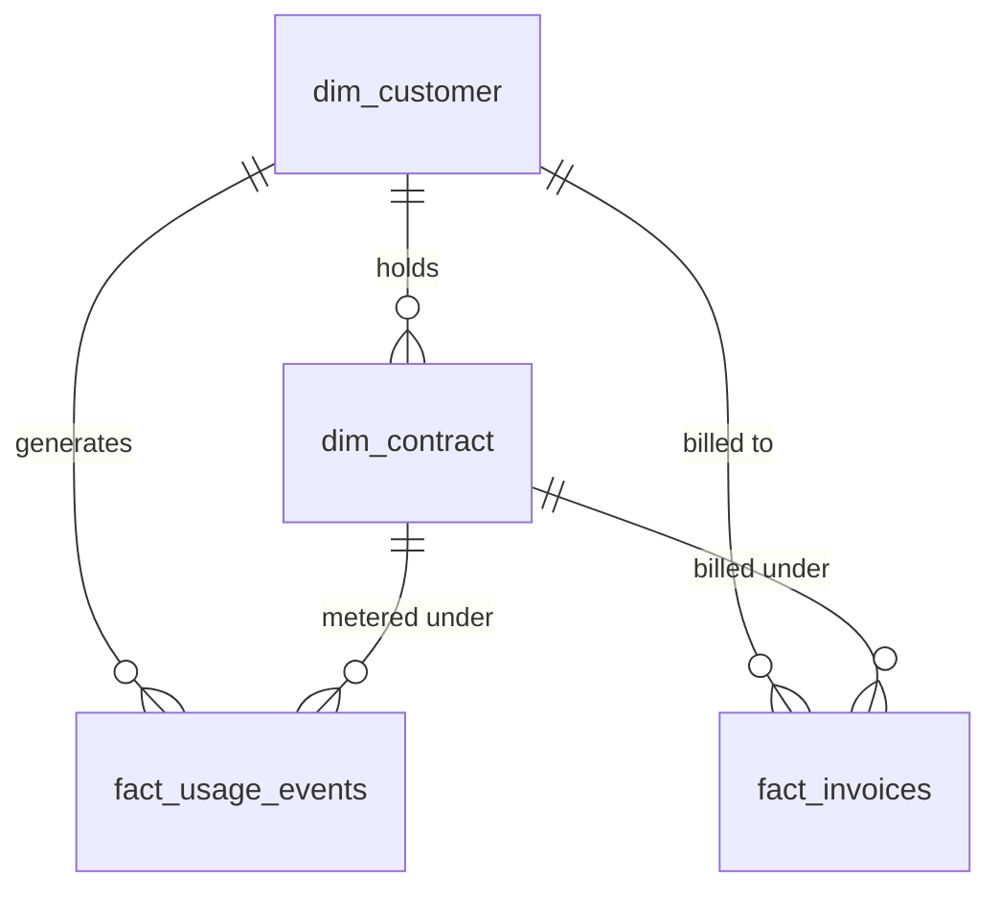

# Data dictionary

Database: `revrecon` (MySQL 8.0.16+, InnoDB, utf8mb4). DDL:
[`sql/01_schema.sql`](../sql/01_schema.sql). Views:
[`sql/02_reconciliation_views.sql`](../sql/02_reconciliation_views.sql).

**Grain** is what one row represents. **Key**: PK = primary key, FK = foreign
key, UK = part of a unique key. Money is `DECIMAL(14,2)` in the reporting
currency.

---

## Star schema

---

## dim_customer

Grain: one row per customer account.

| Column | Type | Key | Null | Business definition |
| --- | --- | --- | --- | --- |
| customer_id | INT UNSIGNED | PK | No | Surrogate identifier for the account. |
| company_name | VARCHAR(150) | | No | Legal or trading name, as shown on invoices. |
| tier | ENUM('Enterprise','Growth','Starter') | | No | Commercial tier. It drives the default discount and SLA target on new contracts. |
| region | ENUM('NA','EMEA','APAC','LATAM') | | No | Sales region that owns the account. |
| signup_date | DATE | | No | Date the account was created. It is on or before the first contract start. |

Indexes: `(tier, region)`, `(signup_date)`.

## dim_contract

Grain: one row per signed contract. A customer can hold several contracts over time.

| Column | Type | Key | Null | Business definition |
| --- | --- | --- | --- | --- |
| contract_id | INT UNSIGNED | PK | No | Identifier of the signed contract. |
| customer_id | INT UNSIGNED | FK -> dim_customer | No | Account that signed the contract. |
| start_date | DATE | | No | First day of the term, always the 1st of a month in this release (OQ-5). |
| end_date | DATE | | No | Last day of the term. Check: `end_date >= start_date`. |
| committed_volume | INT UNSIGNED | | No | Minimum billable units per monthly billing period. If usage is lower, the commitment is billed (BR-02). |
| base_rate | DECIMAL(10,4) | | No | List price per unit, before discount. Check: `> 0`. |
| tier_discount_rate | DECIMAL(5,4) | | No | Fraction off `base_rate`, so 0.2000 = 20%. Check: 0 to 1. Rate card: Enterprise 0.20, Growth 0.10, Starter 0.00. |
| sla_uptime_target | DECIMAL(5,2) | | No | Monthly availability target in percent. Check: 90 to 100. Rate card: Enterprise 99.50, Growth 99.00, Starter 98.00. |

Indexes: `(customer_id)`, `(start_date, end_date)`.

## fact_usage_events

Grain: one row per metered API call.

| Column | Type | Key | Null | Business definition |
| --- | --- | --- | --- | --- |
| event_id | BIGINT UNSIGNED | PK | No | Unique, chronologically assigned event identifier. |
| customer_id | INT UNSIGNED | FK -> dim_customer | No | Account that made the call. |
| contract_id | INT UNSIGNED | FK -> dim_contract | No | Contract the call is metered under. |
| timestamp | DATETIME | | No | When the call happened, in UTC. Backtick it in SQL. |
| units_consumed | INT UNSIGNED | | No | Billable units for the call. It is 0 when `is_error = 1`, because failed calls are not chargeable (BR-02). |
| response_latency_ms | INT UNSIGNED | | No | Server response time in milliseconds. It is informational and not used in billing. |
| is_error | TINYINT(1) | | No | 1 if the call failed. It feeds availability (BR-03). Check: 0 or 1. |
| billing_period | DATE (generated, stored) | | No | First day of the event's month, derived from `timestamp`. It exists so period joins can use an index. |

Indexes: `(contract_id, billing_period)`, `(customer_id, timestamp)`, `(timestamp)`.

## fact_invoices

Grain: one row per issued invoice, and at most one per contract per billing period (BR-06).

| Column | Type | Key | Null | Business definition |
| --- | --- | --- | --- | --- |
| invoice_id | INT UNSIGNED | PK | No | Invoice number from the billing system. |
| customer_id | INT UNSIGNED | FK -> dim_customer | No | Account billed. |
| contract_id | INT UNSIGNED | FK -> dim_contract, UK | No | Contract billed under. |
| billing_period | DATE | UK | No | First day of the billed month. Check: day of month = 1. |
| billed_amount | DECIMAL(14,2) | | No | Net amount invoiced, after any SLA credit. There is no separate credit line (OQ-1). Check: `>= 0`. |
| invoice_status | ENUM('OPEN','PAID','OVERDUE') | | No | Collection status at extract time. It does not affect reconciliation. |

Indexes: unique `(contract_id, billing_period)`, `(customer_id, billing_period)`, `(billing_period)`, `(invoice_status)`.

## audit_seeded_anomalies (verification only)

Grain: one row per anomaly seeded by `scripts/generate_dataset.py`. It is
empty in a production load. It is used only by
`sql/04_verify_detection.sql`.

| Column | Type | Key | Null | Business definition |
| --- | --- | --- | --- | --- |
| anomaly_type | ENUM | | No | `UNBILLED_USAGE`, `TIER_PRICING_VARIANCE` or `MISSED_SLA_CREDIT`. |
| customer_id | INT UNSIGNED | | No | Affected account. |
| contract_id | INT UNSIGNED | PK | No | Affected contract. |
| billing_period | DATE | PK | No | Affected month. |
| invoice_id | INT UNSIGNED | | Yes | The invoice, or NULL for `UNBILLED_USAGE`. |
| event_count | INT UNSIGNED | | No | Usage events in the contract-period. |
| expected_amount | DECIMAL(14,2) | | No | Net expected charge (BR-01 to BR-04). |
| billed_amount | DECIMAL(14,2) | | Yes | What was invoiced, or NULL if nothing was. |
| leakage_amount | DECIMAL(14,2) | | No | `expected_amount - COALESCE(billed_amount, 0)`. |
| detail | VARCHAR(255) | | No | Human-readable description of what was seeded. |

---

## Views

Sign convention for every `leakage_amount`: **positive = revenue lost**
(under-billed), **negative = customer overcharged** (refund exposure).

### vw_contract_period_usage

Grain: contract x billing period with at least one usage event.

| Column | Definition |
| --- | --- |
| customer_id, contract_id, billing_period | Grain keys. |
| event_count | `COUNT(*)` of events. |
| units_consumed | `SUM(units_consumed)`. |
| error_events | `SUM(is_error)`. |
| first_event_at, last_event_at | First and last event timestamps in the period. |

### vw_expected_billing

Grain: same as `vw_contract_period_usage`. Adds every contract term from
`dim_contract`, plus the columns below.

| Column | Definition |
| --- | --- |
| billable_units | `GREATEST(units_consumed, committed_volume)` (BR-02). |
| availability_pct | `100 * (event_count - error_events) / event_count`, rounded to 3 dp, for display only (BR-03). |
| sla_credit_pct | 0.25, 0.10 or 0.00. Calculated by exact integer comparison, not from the rounded `availability_pct` (BR-04). |
| gross_expected_amount | `ROUND(billable_units * base_rate * (1 - tier_discount_rate), 2)` (BR-01). |
| sla_credit_amount | `ROUND(gross_expected_amount * sla_credit_pct, 2)`. |
| net_expected_amount | `gross_expected_amount - sla_credit_amount`. |

### vw_billing_reconciliation (query 1: expected vs invoiced)

Grain: same as `vw_expected_billing`, left-joined to `fact_invoices`. It is
imported into Power BI as **fact_billing_reconciliation**. Every column of
`vw_expected_billing` is included, plus the columns below.

| Column | Definition |
| --- | --- |
| invoice_id, invoice_status, billed_amount | From the matching invoice. NULL when unbilled. |
| leakage_amount | `net_expected_amount - COALESCE(billed_amount, 0)`. |
| exception_type | `UNBILLED_USAGE`, `MISSED_SLA_CREDIT`, `TIER_PRICING_VARIANCE` or `RECONCILED` (BRD Section 6). |
| implied_discount_rate | `1 - (billed_amount + sla_credit_amount) / (billable_units * base_rate)`. It shows the discount the invoice actually applied. NULL when unbilled. |
| cumulative_customer_leakage | `SUM(leakage_amount) OVER (PARTITION BY customer_id ORDER BY billing_period)`. |
| period_total_leakage | `SUM(leakage_amount) OVER (PARTITION BY billing_period)`. |
| customer_exception_rank | `ROW_NUMBER() OVER (PARTITION BY customer_id ORDER BY ABS(leakage_amount) DESC)`. The value 1 marks the customer's largest exception. |

### vw_sla_breach_credits (query 2: SLA breaches and credits)

Grain: a contract-period where `sla_credit_pct > 0`. It is imported as **fact_sla_breaches**.

| Column | Definition |
| --- | --- |
| customer_id, contract_id, billing_period, invoice_id, invoice_status | Keys and the invoice, if one exists. |
| event_count, error_events, availability_pct, sla_uptime_target | Inputs to the breach test. |
| shortfall_pts | `sla_uptime_target - availability`, in percentage points. |
| sla_credit_pct, gross_expected_amount | Credit rate and the charge it applies to. |
| credit_due | `sla_credit_amount`. |
| credit_applied | `gross_expected_amount - billed_amount`, inferred because there is no credit line (OQ-1). NULL if not invoiced. |
| credit_status | `CREDIT_APPLIED`, `CREDIT_MISSED`, `CREDIT_MISMATCH` or `NOT_INVOICED`. |
| breach_count_to_date | Running count of breaches on the contract. A value of 2 or more triggers BR-07 escalation. |
| severity_rank_in_period | `ROW_NUMBER()` by `shortfall_pts` within the month. The value 1 is the worst breach. |

### vw_orphaned_usage_events (query 3: usage never billed)

Grain: one row per usage event in a contract-period with no invoice.

| Column | Definition |
| --- | --- |
| event_id, customer_id, contract_id, billing_period, timestamp, units_consumed, is_error | From `fact_usage_events`. |
| event_seq_in_period | `ROW_NUMBER()` within the contract-period, in time order. Filter to `= 1` for one row per gap. |
| orphaned_events_in_period | `COUNT(*) OVER` the contract-period. |
| orphaned_units_in_period | `SUM(units_consumed) OVER` the contract-period. |
| unbilled_amount_for_period | `net_expected_amount` for the period, which is the revenue to recover. |

---

## CSV extracts (`data/`)

Written by `scripts/generate_dataset.py`. Each CSV has a header row, uses `\n`
line endings, encloses fields in double quotes where needed, and uses `\N` for
NULL, which is the MySQL `LOAD DATA` convention. Columns match the tables
above, in DDL order, except that the generated `billing_period` is not in
`fact_usage_events.csv`. `anomaly_manifest.csv` loads into
`audit_seeded_anomalies`.
